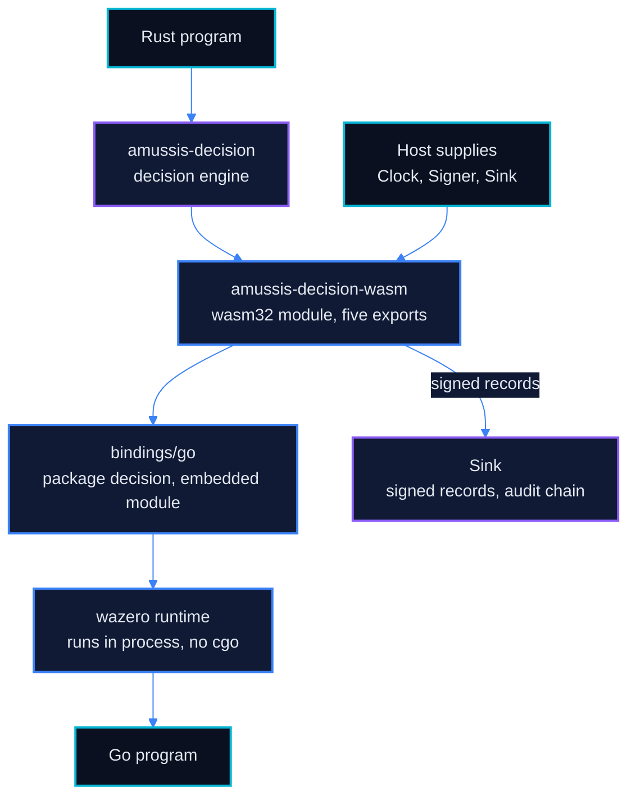

<!-- markdownlint-disable MD013 MD023 MD033 MD036 MD041 -->
<!-- A centred header needs inline HTML, a banner image, indented headings and
     badge lines past 80 columns, so those five rules are off for this file.
     The prose below still wraps at 80. -->
<div align="center">

  

  <!-- badge block: one group, fixed order -->
  <!-- 1 release/version -->
  [](https://github.com/plurano/amussis/releases)
  <!-- 2 CI/build -->
  [](https://github.com/plurano/amussis/actions/workflows/ci.yml)
  [](https://github.com/plurano/amussis/actions/workflows/praetor-api.yml)
  [](https://github.com/plurano/amussis/actions/workflows/reuse.yml)
  [](https://github.com/plurano/amussis/actions/workflows/pages.yml)
  <!-- 3 security/scorecard -->
  [](https://app.codacy.com/gh/plurano/amussis/dashboard)
  [](https://coderabbit.ai)
  <!-- 4 standards -->
  [](AGENTS.md)
  [](CONTRIBUTING.md#modernized-nasa-jpl-power-of-10-rules)
  [](CONTRIBUTING.md#commit-messages)
  <!-- 5 licence -->
  [](#licence)
  <!-- 6 support -->
  [](https://github.com/sponsors/lusoris)
  [](https://ko-fi.com/lusoris)

  **One decision engine for Rust and Go programs**

  *Risk levels, second-person approval, a tamper-evident log and a kill switch*

</div>

Shared Rust crates of the Plurano framework family, kept in one workspace.
`crates/amussis-decision` is the decision engine, imported with its history
from the operating-system repository (`aegis-justitia`).
`crates/amussis-decision-wasm` is the WebAssembly module (five exports,
three host functions: clock, signer, sink), and `bindings/go`
(`package decision`) runs it without cgo.

**[Documentation](https://plurano.github.io/amussis/)** · [Documentation source](docs/index.md)

## Name

Latin *amussis*, the mason's levelling board; *ad amussim* means "exactly".
Pronounced ah-MOOS-sis.

A crate is named after what it does, with the family name in front:
`amussis-decision` is the decision engine. The deity names (Justitia, Minerva,
Vesta) stay the operating system's names for its components.

## Why Amussis

- The same decision engine serves Rust (`amussis-decision`) and Go
  (`bindings/go`), where the WebAssembly module is embedded and run in the
  process with wazero: no cgo, no shared library and no Rust toolchain for the
  consumer.
- The WebAssembly module has no access to the operating system and asks the
  host for three effects only: `Clock`, `Signer` and `Sink`.
- Every Go block in the README is compiled and run: each stands line for line
  in `examples/go-consumer/example_test.go`, whose examples check their output.
- `tools/wasm_module.py check` rebuilds the WebAssembly module from source and
  compares it with the committed module that `bindings/go` embeds: byte for
  byte first, and on a Windows or macOS host whose bytes differ, up to function
  order (see [Exceptions](https://plurano.github.io/amussis/exceptions/)).
- `tools/third_party_notices.py` writes the third-party licence notices of the
  WebAssembly module from the lock file and the pinned toolchain, and holds the
  committed notices to them.

## Get started

### Rust

From `v0.2.0` on, `amussis-decision` is published to crates.io:

```sh
cargo add amussis-decision
```

### Go

Publishing a release tags `bindings/go/v<version>` for the Go module:

```sh
go get github.com/plurano/amussis/bindings/go@v0.2.0
```

See [Go binding](#go-binding) below for configuration, continuation,
adjudication and halt handling.

## At a glance



| Path | Holds |
| :--- | :--- |
| `crates/` | One directory per library crate; each joins the workspace by a written-out line in `Cargo.toml`. |
| `crates/amussis-decision/` | The decision engine, imported with its history from the operating-system repository, where it is the crate `aegis-justitia`. |
| `crates/amussis-decision-wasm/` | The decision engine as a WebAssembly module: five exports, three host functions (clock, signer, sink). |
| `bindings/go/` | The Go module that embeds the WebAssembly module and runs it without cgo; package `decision`. |
| `examples/go-consumer/`, `tools/readme_snippets.py` | A Go module that requires the binding as a program outside this repository does, holding every Go block of this README in examples that run; and the check that each block stands there line for line. |
| `exceptions.toml`, `tools/exceptions_check.py` | The workspace's exceptions to its own rules, each with one rule, one file, a reason and an end date, and the check that holds every entry to what it names. |
| `tools/wasm_module.py` | Builds the WebAssembly module and compares it with the one `bindings/go` embeds: byte for byte first, up to function order on a Windows or macOS host whose bytes differ. |
| `tools/settings_sync.py` | Holds the shared toolchain and lint settings to their recorded source. |
| `tools/third_party_notices.py`, `tools/notices/` | Writes the notices of the WebAssembly module from the lock file and holds the committed ones to it; the standard library part per toolchain, and the planted crate of the licence check. See [Licence](#licence). |
| `deny.toml` | The licences a crate of the locked graph may carry. |
| `tools/origin_names.py` | Counts the operating system's component numbers and `aegis.` schema tags in the crates' sources. They may stand only in the line that says where the crate came from. |
| `docs/handover/` | What left this repository for the operating-system repository, each with paths, hashes and the steps to switch: the service unit, and the conversation schemas with the subsystem graph. |
| `tools/apicompat/`, `.github/workflows/praetor-api.yml` | Written by the Praetor engine: on a pull request, compares the exported API of the Go module with the base commit. |
| `settings-source.json` | The record: source repository, commit, file hashes and manifest settings. |
| `.github/workflows/release.yml`, `release-build.yml` | The release: a version tag builds, signs and attests the release files and stores them in a draft release. See [Releases](https://plurano.github.io/amussis/releases/). |
| `LICENSES/`, `REUSE.toml` | Licence text and the annotations for files that cannot carry a header. |
| `.standards.yaml`, `.standards.lock`, `.standards-baseline.json` | The Praetor adoption: profile, pinned policy and the recorded debt the audit lets shrink, never grow. |

## Guides and reference

### Go binding

The Go blocks of this README are compiled and run: each stands line for line
in [`examples/go-consumer/example_test.go`](examples/go-consumer/example_test.go),
whose examples check their output.

```go
import "github.com/plurano/amussis/bindings/go/decision"

engine, err := decision.New(ctx, decision.Config{
    KeyID:        "host-key-01",
    SinkDeadline: 250 * time.Millisecond,
    Mode:         decision.Compiled,
    Clock:        clock, Signer: signer, Sink: sink,
})
if err != nil {
    return err
}
outcome, err := engine.Decide(ctx, proposalJSON)
if outcome.Permits() {
    act() // only a permitted action runs
}
```

The package embeds the WebAssembly module and runs it in the process with
[wazero](https://github.com/tetratelabs/wazero): no cgo, no shared library and
no Rust toolchain for the consumer. The module has no access to the operating
system. It asks the host for three effects and nothing else, and the loader
refuses a module that imports anything beyond them:

| Effect | The host supplies | When it cannot deliver |
| :--- | :--- | :--- |
| `Clock` | Seconds since the Unix epoch. | The decision is blocked and the engine halts. |
| `Signer` | A signature over the SHA-256 digest of each record. | Blocked and halted; nothing unsigned reaches the sink. |
| `Sink` | Durable storage of each signed record, within a deadline. | Blocked and halted; the engine keeps no record the sink does not hold. |

No effect has a default. `New` refuses a missing one, and a module that imports
a host function the host does not hold fails to load. `Mode` is named by the
caller as well: `Compiled` (amd64 and arm64; `New` returns an error on any other
architecture) or `Interpreted` (no machine code of its own, about sixty times
as long per decision as `Compiled` on amd64, per `BenchmarkDecide`); the
package never picks one or falls back to the other. A module that traps, or an answer the
loader cannot read, yields a blocked outcome and an error, and the engine
answers blocked from then on.

The audit chain lives in the `Sink` and has no bound of its own: the module
keeps a window of 4,096 records in memory and drops it when it is full
(`TestTheChainRunsPastTheWindowAsOneChain`). A program that starts again does
not start a second chain. It hands the last record its sink stored to
`decision.Continue`, and the next record links onto it:

```go
engine, err := decision.Continue(ctx, config, decision.Continuation{Head: lastStored})
```

The module recomputes the digest of that record and reads the chain position
and the halt state out of its content; a record that does not hash to its
digest is refused with `decision.ErrHead`. A chain that ends halted continues
halted, so a restart is no release.

A halt is a record of the chain and stands at a risk level: the level of the
action the engine had in hand when a fault halted it, and the highest level
where no action names one. `Continuation.Release` is the one release of a halt
the binding has. It names the person who releases and the checkers, and the
engine holds it to the approval rule it holds an action of that level to:

```go
from := decision.Continuation{
    Head:    lastStored,
    Release: &decision.Release{Releaser: "olga", Checkers: []string{"petra"}},
}
engine, err := decision.Continue(ctx, config, from)
```

| Level of the halt | Who releases it |
| :--- | :--- |
| Routine or material action, standard oversight | The releaser alone. |
| Consequential action, standard oversight | The releaser and one checker. |
| Any action under Annex III oversight, and a halt with no level of an action | The releaser and two distinct checkers. |

No checker is the releaser. The release is written into the chain as a record
of its own before the first decision, and a release that is refused writes
nothing and sets up no engine:

| Error | The release is refused because |
| :--- | :--- |
| `decision.ErrApproval` | a checker the level demands is missing, named twice, or is the releaser |
| `decision.ErrNotHalted` | the chain does not end halted |
| `decision.ErrCompromised` | the chain is halted as compromised; that halt is not released |
| `decision.ErrRelease` | a person is no identity of the engine, or more than two checkers are named |
| `decision.ErrReleaseFailed` | the clock, the signer or the sink did not deliver the release record |

The cases are replayed both ways in `bindings/go/decision/continue_test.go`
(`TestTheLowestLevelIsReleasedByOnePerson`,
`TestAReleaseWithoutTheNeededApprovalIsRefused`).

An action the engine holds (`RequireApproval`) is named by the `id` of its
proposal. The program brings the checkers' decision to the engine with
`Adjudicate`:

```go
outcome, err := engine.Adjudicate(ctx, decision.Adjudication{
    IntentID: "intent-0042",
    Vote:     decision.Approve,
    Checkers: []string{"carol"},
})
if outcome.Permits() {
    act() // approved: the held action runs
}
```

Who may approve is the program's decision. The engine holds the checkers it is
given to the approval rule of the action (one checker, or two distinct ones
under Annex III oversight, none of them the maker of the proposal) and writes
the vote into the chain. Only an approval permits:

| Outcome class | Meaning | Record of the vote |
| :--- | :--- | :--- |
| `Allowed` | The checkers approved; the held action may run. | the approval |
| `Rejected` | The checkers rejected the action. | the rejection |
| `NotAdjudicated` | The engine took no vote; `Detail` says why. | none |
| `Refused` | The adjudication cannot be read (`RefusedAdjudication`). | none |

| `Detail` of `NotAdjudicated` | The engine took no vote because |
| :--- | :--- |
| `UnadjudicatedUnknownRequest` | no action is held under the intent id |
| `UnadjudicatedAlreadyDecided` | the action was decided before |
| `UnadjudicatedExpired` | its approval window of 300 seconds has closed |
| `UnadjudicatedApproval` | the checkers do not satisfy the approval rule |
| `UnadjudicatedHalted` | the engine is halted |
| `UnadjudicatedClockUnavailable` | the clock could not be read; the engine halts |
| `UnadjudicatedUnrecorded` | the vote could not be signed or stored; the hold ends undecided and the engine halts |
| `UnadjudicatedEngine` | the engine refused for a reason this list does not name |

`Halt` is the operator stop. It names the risk level the halt stands at, which
is the level its release is held to:

```go
err := engine.Halt(ctx, operatorHash, decision.LevelConsequential)
```

The second argument is the person who halts, as the keyed hash the host knows
that person by. The record of the halt names that person where the call engaged
the halt or made it stricter; a call that changes nothing about a halt writes
no record (`TestTheRecordOfAHaltNamesThePersonWhoHalted`).

The engine permits nothing after `Halt`, whatever it returns. `nil` says the
halt is a record of the chain; `decision.ErrHaltUnrecorded` says the engine is
halted and the record could not be signed or stored. `decision.ErrHaltUnnamed`
says the engine is halted and the person is no identity: a halt is not refused
for the person it is called with, and its record then names nobody
(`TestAHaltByNoIdentityHaltsAndNamesNobody`). A `Level` that is none of
the six, the zero value included, halts at the highest level, and a second
halt never lowers the level a halt stands at
(`TestAHaltAtNoLevelStandsAtTheHighest`, `TestASecondHaltNeverLowersTheLevel`).

The cases that must not permit are replayed in
`bindings/go/decision/adjudicate_test.go`: a vote for an action that is not
held (`TestAnAdjudicationForAnActionThatIsNotHeldIsNotTaken`), a vote that
cannot be signed or stored
(`TestAVoteThatCannotBeSignedOrStoredIsNoVoteAndHalts`) and a halt that cannot
be recorded (`TestAHaltThatCannotBeRecordedIsStillAHalt`). The byte layout of
an adjudication and the outcome code are in the documentation of
`crates/amussis-decision-wasm/src/lib.rs` and `src/wire.rs`.

Limits as of this state:

- Actions an earlier engine held are not carried over a continuation and stay
  unreleased: an adjudication for one finds no held action.
- A running engine has no call that lifts a halt. A halt set with `Halt` is
  released as every halt is, by a continuation of the stored chain with a
  `Release` (`TestAnOperatorHaltIsReleasedWithTheApprovalOfItsLevel`).
- The head record is checked for integrity, not for origin. The module verifies
  no signature, and it cannot know that the record is the last one stored. A
  continuation from another record leaves two records with one sequence number
  in the store, which a walk over the store shows
  (`TestAContinuationFromAnotherRecordThanTheHeadShowsInTheStore`); the module
  does not prevent it.
- The record of a halt names the person whose call engaged it or made it
  stricter, and nobody else. A person who calls `Halt` on an engine that is
  halted already at that level or a stricter one is in no record; a host that
  has to show every such call keeps that itself. See
  [Identities in the audit chain](#identities-in-the-audit-chain).
- A chain written before interface version 5 is not continued: its records
  carry no identities, and a head record in that layout is refused
  (`a_head_in_the_layout_without_the_names_is_refused` in
  `crates/amussis-decision/tests/record_principals.rs`).
- A halt whose record never reached the sink (a signer or a sink that failed) is
  not in the stored chain, so a continuation from the stored head starts without
  it. The halted engine writes the halt with the next record the sink stores.
- The person of a halt whose record never reached the sink is kept in the
  running engine only. The next call of `Halt` writes the record owed with that
  person, whoever calls (`a_named_halt_record_that_failed_is_written_with_its_person`
  in `crates/amussis-decision/tests/halt_record.rs`). An engine that ends before
  that call takes the name with it: no record of the stored chain names that
  person for the halt.
- The binding has run on the three CI hosts only: Linux amd64, macOS arm64 and
  Windows amd64, both modes on each. The Linux host also runs it as linux/386,
  where `Interpreted` passes every test and `New` refuses `Compiled`. No other
  operating system or architecture has run it.

The committed module is the build of the source beside it: `tools/wasm_module.py
check` rebuilds it with the machine's paths rewritten. On a Linux x86_64 host
one differing byte fails the check; a Windows or macOS host is held to the
comparison described below. After a change to the engine or the export crate,
run `python3 tools/wasm_module.py update` and commit the module with the
change.
Renovate heads receive the regenerated files as artifact `regenerated-<sha>`
from `.github/workflows/regenerate.yml`.
The module is the build of a Linux x86_64 host, and only such a host is held
to its exact bytes. A Windows or macOS host can build the same functions in
another order, so when its bytes differ the check runs
`tools/module-compare` (package `amussis-module-compare`), which compares the
two modules up to function order. A difference in code or data fails on every
host, with no exception. `update` is refused on both hosts.

The build rewrites every source directory of the module's library closure to
its forward-slash name with `--remap-path-prefix`. `rustc` replaces only a
prefix, so without that the rest of an embedded source path keeps a Windows
host's backslashes and the data section differs (issue #2, run 38863474754).

### Identities in the audit chain

A record that is about a person names that person, and the store keeps those
bytes for as long as it keeps the chain. What a host passes in as the maker of
a proposal, as a checker or as the person who halts or releases a halt is
therefore what its audit log holds. Pass a keyed hash, never a name.

| Record | Names | Shown by |
| :--- | :--- | :--- |
| A decision: passed, blocked or held | the maker of the proposal | `TestTheRecordOfADecisionNamesTheMaker` |
| A vote: approved or rejected | the maker and the checkers who cast it | `TestTheRecordOfAVoteNamesTheCheckers` |
| The release of a halt | the releaser and the checkers who approved | `TestTheRecordOfAReleaseNamesTheReleaserAndTheApprovers` |
| A halt a person called with `Halt` | that person, at the level the halt stands at | `TestTheRecordOfAHaltNamesThePersonWhoHalted` |
| A halt the engine engaged itself on a fault, and a halt by no identity | nobody | `TestAHaltByNoIdentityHaltsAndNamesNobody` |

The library does not hash and does not read an identity. It takes 1 to 64
bytes of letters, digits and `. - _ : @ /`, writes them into the record as
they came, and treats two persons as one exactly when their bytes are equal
(`TestAMakerAmongTheCheckersIsNotRecorded`). It cannot tell a pseudonym from a
name, so the rule is the host's to keep:

1. **A keyed hash of your own identifier.** HMAC-SHA-256 over the identifier
   your system knows the person by, in lower-case hexadecimal, is 64
   characters: the longest identity the engine takes
   (`TestAnIdentityOfSixtyFourBytesIsRecordedByteForByte`).
2. **Never an unkeyed hash.** Identifiers are few and guessable; a plain
   SHA-256 of one is undone by hashing the list of candidates.
3. **Every role, one key, one spelling.** Hash the maker, the checkers and the
   releaser the same way. Only then is one person one string of bytes, and
   only then does the engine see a maker who votes on the own proposal. The
   same hash once in upper and once in lower case is two persons to the engine.
4. **One key per log period.** Keep the key outside the store. To show who a
   record names, compute the hash of the candidate again and compare. When the
   key is destroyed, the records of that period name persons nobody can
   recover, and the chain verifies as before, because no byte of it changes.

```go
func identity(key []byte, id string) string {
    mac := hmac.New(sha256.New, key)
    mac.Write([]byte(id))
    return hex.EncodeToString(mac.Sum(nil))
}
```

Each record that names a person also states the risk level its approval rule
was asked at. A reader of the store holds a record to that rule with the
record alone: a vote or a release with fewer checkers than its level demands,
with the maker among the checkers or with one checker named twice has no
canonical content, and is refused when it is appended and when the chain is
verified (`a_record_without_the_identities_it_needs_is_refused` and
`a_maker_among_the_checkers_is_refused_by_byte_equality` in
`crates/amussis-decision/tests/record_principals.rs`). The largest record, a
vote of two checkers with every identity at 64 bytes, has a content of 454
bytes of the 512 a record may have
(`the_largest_record_fits_the_preimage_bound`).

### On the documentation site

- [Verification gate](https://plurano.github.io/amussis/verification/): one
  target (`make verify-all`), the same one CI runs on Linux, macOS and Windows.
- [Exceptions](https://plurano.github.io/amussis/exceptions/): dated rule
  exceptions in `exceptions.toml` and the checks that hold them.
- [Shared settings](https://plurano.github.io/amussis/shared-settings/): the
  toolchain pin, formatter and lint tables taken from the operating-system
  repository (`settings-source.json`).
- [Releases](https://plurano.github.io/amussis/releases/): what the release
  workflow files do from `v0.1.0` on.
- [Handover records](docs/handover/) and
  [Decision records](docs/adr/README.md).

## Contribute

```sh
make verify-all
```

One target, the same one CI runs: three jobs, on Linux, macOS and Windows,
share one step list in `.github/workflows/ci.yml`, and the rule set in
`.github/rulesets/main.json` requires all three. What the gate needs and checks
is on the [Verification gate](https://plurano.github.io/amussis/verification/)
page.

See [CONTRIBUTING.md](CONTRIBUTING.md) and [SECURITY.md](SECURITY.md).

## Support

Questions and ideas go to
[Discussions](https://github.com/plurano/amussis/discussions), defects to
[issues](https://github.com/plurano/amussis/issues), and security reports to
a [private advisory](https://github.com/plurano/amussis/security/advisories/new),
as [SECURITY.md](SECURITY.md) asks.

The maintainer's work on the Plurano crates can be sponsored on
[GitHub Sponsors](https://github.com/sponsors/lusoris),
[Ko-fi](https://ko-fi.com/lusoris) or
[Patreon](https://www.patreon.com/Lusoris), any amount; sponsors are thanked,
and no support or priority is sold.

## Roadmap and releases

Public since 2026-10-11. The first release,
[`v0.1.0`](https://github.com/plurano/amussis/releases/tag/v0.1.0), brought a
decision engine (risk levels, second-person approval, tamper-evident log, kill
switch) here from the operating-system repository; its files are on the forge
only. From [`v0.2.0`](https://github.com/plurano/amussis/releases/tag/v0.2.0)
on, publishing a release also publishes both crates to crates.io and tags the
Go module; see [Releases](https://plurano.github.io/amussis/releases/).

A version tag builds, signs and attests the release files; the Releases page
says how to check them. Planned work is tracked in the
[milestones](https://github.com/plurano/amussis/milestones).

## Licence

EUPL-1.2, see [LICENSE](LICENSE). Source files carry an SPDX header; the gate
fails on a file that has neither a header nor an entry in `REUSE.toml`.
It also fails when `LICENSE` is not the text of `LICENSES/EUPL-1.2.txt`.

The WebAssembly module is a compiled file and holds more than this
repository's code: the registry crates it links and the Rust standard library
are part of it. Its licence is `EUPL-1.2 AND MIT AND Unicode-3.0`: MIT for
the crates and the standard library, where MIT is taken wherever a choice is
offered, and Unicode-3.0 for the Unicode tables of the standard library.
[`bindings/go/decision/THIRD-PARTY-NOTICES.txt`](bindings/go/decision/THIRD-PARTY-NOTICES.txt)
names each of them with its licence text, and a release ships it beside the
module. Whoever passes the module or the Go package on passes the notices on
with it.

The notices are generated, not written:

```sh
python3 tools/third_party_notices.py check    # what the gate runs; no network
python3 tools/third_party_notices.py update   # after a dependency change
```

The crates come from `cargo metadata` for the module's target: what the
module crate reaches through normal dependencies. Crates that only run at
build time, procedural macros among them, leave no code in the module and
are not listed. A linked crate that offers no MIT, or ships no `LICENSE-MIT`,
is refused, and so is a `REUSE.toml` that names another licence for the
module. The standard library part is one file per toolchain under
`tools/notices/`, written from the notice documents that toolchain ships
(`share/doc/rust/COPYRIGHT-library.html`); a toolchain update without its
file is refused.

A second check covers the whole locked graph, build-time crates included:
`cargo deny check licenses` on the list in `deny.toml`. The gate runs it once
more on `tools/notices/refused/`, a crate under a licence the list does not
name, and fails when that crate passes.

### Dependencies

`Cargo.lock` is committed and every cargo step runs with `--locked`;
`bindings/go/go.sum` is committed and every Go step runs with `-mod=readonly`.
A release of an outside dependency is taken up three days after its publication
at the earliest; releases of this workspace's own crates are taken up at once.

## Standards and governance

This repository follows the High-Integrity Systems Standards (HISS-21) and the
NASA/JPL Power of 10 rules; see [AGENTS.md](AGENTS.md) and
[CONTRIBUTING.md](CONTRIBUTING.md).

<!-- praetor:readme-governance:start -->
[![Documentation Governance][praetor-docs-badge]][praetor-docs-runs]

Praetor manages this repository's declared governance policy. This managed
block records adoption state; it is not a verification certificate.

**Verification**: `make verify-all` runs the repository's configured
verification cascade.

**HISS Audit**: `praetorctl audit` enforces policy, generated-surface
integrity, and the debt ratchet.

**Context Sync**: `praetorctl compile-context --verify` verifies every
generated agent context against `AGENTS.md`.

**Documentation**: `make docs-lint` enforces locked Markdown style and the
private scratch-link policy.

**Debt Baseline**: `.standards-baseline.json` anchors the debt ratchet at
1 recorded infraction; audit forbids growth.

[praetor-docs-badge]: https://github.com/plurano/amussis/actions/workflows/praetor-docs.yml/badge.svg
[praetor-docs-runs]: https://github.com/plurano/amussis/actions/workflows/praetor-docs.yml
<!-- praetor:readme-governance:end -->
