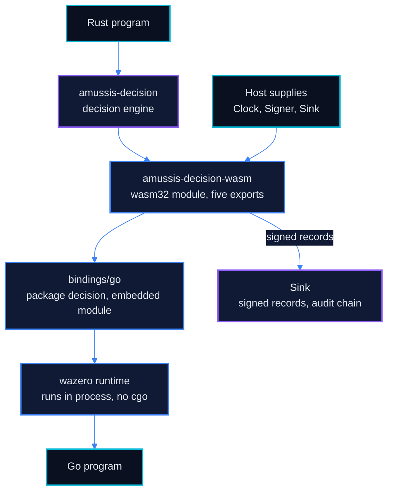

<!--
SPDX-FileCopyrightText: 2026 Lusoris <lusoris@pm.me>
SPDX-License-Identifier: EUPL-1.2
-->

# Amussis

Shared Rust crates of the Plurano framework family, kept in one workspace.
`crates/amussis-decision` is the decision engine, imported with its history
from the operating-system repository (`aegis-justitia`).
`crates/amussis-decision-wasm` is the WebAssembly module (five exports,
three host functions: clock, signer, sink), and `bindings/go`
(`package decision`) runs it without cgo.

## Name

Latin *amussis*, the mason's levelling board; *ad amussim* means "exactly".
Pronounced ah-MOOS-sis.

A crate is named after what it does, with the family name in front:
`amussis-decision` is the decision engine. The deity names (Justitia, Minerva,
Vesta) stay the operating system's names for its components.

## Why Amussis

- The same decision engine serves Rust (`amussis-decision`) and Go
  (`bindings/go`), where the WebAssembly module is embedded and run in the
  process with wazero: no cgo, no shared library and no Rust toolchain for the
  consumer.
- The WebAssembly module has no access to the operating system and asks the
  host for three effects only: `Clock`, `Signer` and `Sink`.
- Every Go block in the README is compiled and run: each stands line for line
  in `examples/go-consumer/example_test.go`, whose examples check their output.
- `tools/wasm_module.py check` rebuilds the WebAssembly module from source and
  compares it byte for byte with the committed module that `bindings/go`
  embeds.
- `tools/third_party_notices.py` writes the third-party licence notices of the
  WebAssembly module from the lock file and the pinned toolchain, and holds the
  committed notices to them.

## Pages

- [Verification gate](verification.md): one target (`make verify-all`), the
  same one CI runs on Linux, macOS and Windows.
- [Exceptions](exceptions.md): dated rule exceptions in `exceptions.toml` and
  the checks that hold them.
- [Shared settings](shared-settings.md): the toolchain pin, formatter and lint
  tables taken from the operating-system repository (`settings-source.json`).
- [Releases](releases.md): what the release workflow files do from `v0.1.0` on.
- [Handover: conversation schemas and subsystem graph](handover/aegis-os-schemas.md)
  and [Handover: service unit](handover/aegis-os-service-unit.md).
- [Architectural Decision Records](adr/README.md).

The Go binding guide is in the repository [README](https://github.com/plurano/amussis#go-binding).
